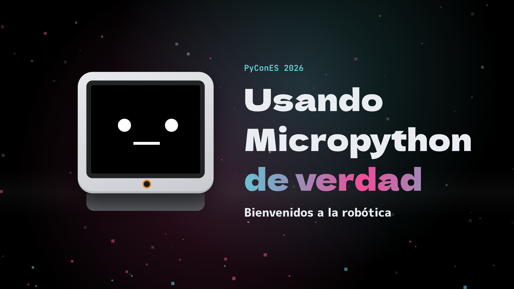

|

.. image:: https://img.shields.io/github/actions/workflow/status/Nekmo/micropython-robotica-presentacion/build.yml?style=flat-square&branch=master
  :target: https://github.com/Nekmo/micropython-robotica-presentacion/actions?query=workflow%3ABuild
  :alt: Latest CI build status

=======================================================
Usando Micropython de verdad: bienvenidos a la robótica
=======================================================
El año pasado, 2025, fue para mí el año de los microcontroladores y de Micropython. Primero con una ponencia en
OpenSouthCode Málaga, y luego aquí, en PyConES en formato de taller. Ambos tuvieron gran acogida, pero en ambos llegaba
siempre la misma pregunta: ¿y esto para qué sirve? ¿de verdad puede usarse Micropython en algo más serio? Pues bien,
vamos a demostrar que Micropython puede usarse en proyectos más serios. Y lo vamos a hacer, desde el mundo de la
robótica. Bienvenidos todos a la robótica con Micropython.

Nuestro robot será Stack-chan, un adorable robot opensource y hardware libre ya montado y de precio asequible,
que programaremos en Micropython.

📽️ La **presentación** está `disponible online <https://nekmo.github.io/micropython-robotica-presentacion/>`_ ya
compilada para su visualización.

✏️ Todos los **ejemplos** están en la carpeta `demos <demos/>`_ y pueden ejecutarse en el robot o en el simulador.

Contenido
---------

* Bienvenida e introducción.
* Qué es Micropython y su uso en microcontroladores.
* Casos de uso: programar a Stack-chan.
* Primer reto: controlar los servos.
* Segundo reto: sensores del robot.
* Tercer reto: micrófono y cámara.
* Cuarto reto: dibujar en la pantalla.
* Quinto reto: inteligencia artificial en un ESP32.
* Demostración completa con Stack-chan.
* Python Málaga, recursos y contacto.

Demos en directo
----------------
La presentación es autocontenida: no necesita Internet ni programas externos. Las diapositivas de demo incluyen un
editor (Monaco) que ejecuta el código en uno de estos destinos:

* **Robot (USB)**: Stack-chan con UIFlow 2 conectado por USB. Usa Web Serial, por lo que requiere Chrome o Edge y
  servir la presentación desde ``localhost`` o HTTPS (``make serve``).
* **Simulador**: Stack-chan simulado dentro del navegador. Es MicroPython compilado a WebAssembly ejecutándose en un
  Web Worker, con los módulos del robot (``M5``, ``hardware.stackchan``, ``lvgl``, ``m5ui``, ``machine``, ``camera``,
  ``dl``...) simulados. Los *shims* están adaptados de `esp-emulator`. El simulador también entiende el hardware a bajo
  nivel: el bus de servos Feetech SCS por ``machine.UART`` y, por ``machine.I2C``, el sensor táctil (Si12T), el de
  proximidad (LTR-553) y los LEDs del expansor de E/S. El recuadro del simulador muestra el robot en 3D (servos, LEDs
  y pantalla): se puede tocar su cabeza con el ratón, agitarlo, inclinarlo, acercar la mano o usar el micrófono real.
  La cámara usa la webcam, y como no hay red neuronal, ``dl`` simula una persona que pasea delante del robot.

El simulador necesita ``SharedArrayBuffer``. GitHub Pages no permite enviar las cabeceras COOP/COEP, así que
``coi-sw.js`` (un *service worker* en la raíz del sitio) las añade y la página se recarga una vez al abrirla.

Atajos:

* ``Ctrl+Enter`` en el editor ejecuta el código.
* ``C`` cambia la fuente del recuadro de cámara: cámara o simulador.
* ``Ctrl+F11`` pone la cámara a pantalla completa.
* El botón *Ajustes* (abajo a la izquierda) elige la cámara, el modo espejo y el zoom.
* *Parar* y *Reiniciar* liberan además los servos del robot (par desactivado).

Demos
-----
Las demos no usan la librería de Stack-chan salvo para encender la alimentación de los servos: hablan con el hardware
directamente, con ``machine.UART`` y ``machine.I2C``, para que sirvan como ejemplo para otros robots.

* ``demo1a_bus``: paquetes del bus de servos Feetech SCS a mano; mueve la cabeza y lee su posición.
* ``demo3_cabeza``: sensor táctil de la cabeza (Si12T) y LEDs.
* ``demo4_imu``: orientación con el acelerómetro: de pie, inclinado, tumbado, boca abajo o agitado.
* ``demo5_proximidad``: Stack-chan tímido, con el sensor de proximidad (LTR-553).
* ``demo6_microfono``: vúmetro con los LEDs.
* ``demo7_camara``: lo que ve la cámara; al tocar la pantalla, una foto.
* ``demo8_pantalla``: dibujar la cara con primitivas de M5GFX.
* ``demo10_caras``: sigue la cara más cercana (ESP-DL) con control proporcional.
* ``demo12_final``: bailes con el port completo del firmware.

Los servos se mueven siempre con arranques suaves: un arranque brusco a más de ~60°/s provoca un pico de corriente
que reinicia la placa.

Robot
-----
Las demos funcionan con **UIFlow 2 para StackChan** (MicroPython 1.27). Si el robot trae el firmware oficial de M5Stack
en C++, hay que grabarle UIFlow 2 (por ejemplo con M5Burner, o con ``esptool``), haciendo antes una copia de seguridad
de la flash::

    esptool --port /dev/ttyACM0 -b 921600 read-flash 0 0x1000000 copia.bin
    esptool --port /dev/ttyACM0 -b 921600 erase-flash
    esptool --port /dev/ttyACM0 -b 921600 write-flash 0x0 uiflow2-stackchan.bin

La carpeta ``robot`` contiene el port del firmware de Stack-chan a Micropython (``libs/stackchan`` y sus imágenes),
que usa ``demo12_final``. El simulador lo incluye automáticamente; para el robot real::

    make upload     # sube robot/libs, robot/res y robot/main.py con mpytool

``make upload`` **sustituye el** ``main.py`` del robot por el del port. Si solo quieres las librerías para la demo
final, copia ``robot/libs/stackchan`` a ``/flash/libs/`` y ``robot/res/stackchan`` a ``/flash/res/``. UIFlow 2 trae su
propio paquete ``/system/stackchan``, así que el port se pone primero en ``sys.path``.

Modelo 3D
---------
El modelo 3D de Stack-chan está en ``models/stackchan.blend`` (Blender 5.0). La presentación usa
``_static/models/stackchan.glb``, generado con ``models/export_stackchan.py``, que sustituye los materiales del
original (casi negros) por los colores del StackChan real (carcasa gris claro, frontal negro, aro de cámara
naranja y base gris oscura) y añade los pivotes de los servos (``yaw`` y ``pitch``),
el plano de la cara, los 12 LEDs y las 3 zonas táctiles, enrasados en la parte superior de la cabeza::

    make model      # requiere blender en el PATH (o BLENDER=/ruta/a/blender)

La placa ESP32-S3 y los servos (de modelismo y de bus) se construyen por código con three.js.

Dependencias incluidas
----------------------
Todo lo que la presentación carga está en el repositorio, en ``_static/vendor``:

* MicroPython 1.29 para WebAssembly (MIT).
* Monaco Editor 0.57, sin los *workers* de otros lenguajes (MIT).
* three.js 0.187 y su cargador glTF (MIT).
* Tipografías Dela Gothic One, M PLUS 1p y JetBrains Mono, subconjuntos latinos (SIL OFL 1.1).

Diseño
------
La presentación es un juego de planos técnicos de un robot pequeño: las diapositivas claras son hojas de dibujo sobre el
plástico blanco de Stack-chan, las oscuras son planos en tinta, y los títulos de sección ocurren en la propia pantalla
del robot, con su cara viva que sigue al puntero y parpadea. Cada diapositiva declara su escena con
``:data-scene:`` (``face``, ``sheet``, ``blueprint`` o ``neon``), su cajetín con ``:data-sheet:`` y, si quiere, un fondo
animado con ``:data-fx:``.

Directivas propias (``stackchan_ext.py``):

* ``micropython-demo``: editor en vivo. Opciones ``:file:``, ``:height:``, ``:name:`` y ``:steps:`` (líneas
  resaltadas paso a paso, como ``2-4|6``).
* ``stackchan-3d``: modelos 3D (three.js). ``:mode:`` ``anatomy`` (partes del robot), ``board`` (placa ESP32-S3),
  ``servo`` (cómo funciona un servo, con PWM y bus UART), ``peek`` (Stack-chan entrando en las diapositivas de
  sección) o ``mirror`` (sigue al simulador). ``:steps:`` revela las etiquetas paso a paso.
* ``stackchan-intro``: la portada, en la que Stack-chan arranca Micropython y despierta.
* ``stackchan-face``: la cara animada de Stack-chan, con ``:emotion:``.
* ``screen-robot``: un Stack-chan pequeño con su pantalla animada (``gfx``, ``lvgl`` o ``mail``).
* ``path-anim``: animaciones de IA en el chip o en la nube.
* ``widget``: explicaciones interactivas (``pcontrol``, el control proporcional).
* ``camera-view``: hueco donde se acopla la cámara en vivo.

Compilación
-----------
Requiere Python 3.12+ y ``sassc``::

    # Instalar dependencias
    pip install -r requirements.txt
    # Compilar estilos y presentación
    make revealjs
    # Servir en http://localhost:8000 (necesario para Web Serial y la cámara)
    make serve

Tras la compilación pueden verse los ficheros resultantes en el directorio ``_build``. Al hacer *push* a ``master``,
GitHub Actions compila la presentación y la publica en la rama ``presentation`` (GitHub Pages).

Presentaciones anteriores
=========================

* Charla: `github.com/Nekmo/micropython-presentacion <https://github.com/Nekmo/micropython-presentacion>`_.
* Taller: `github.com/Nekmo/micropython-workshop <https://github.com/Nekmo/micropython-workshop>`_.

Copyright
=========
Licencia MIT. Ver fichero ``LICENSE.txt``.

Nekmo 2026.
