.. _intro:

############################
Usando Micropython de verdad
############################

.. revealjs-section::
    :data-scene: boot
    :data-background-color: #000000
    :data-transition: fade
    :data-transition-speed: slow

.. stackchan-intro::

.. revealjs-notes::

   (Esperar a que arranque la animación: el robot se enciende, escribe en su consola de Micropython y despierta.)
   Hola a todos, muchas gracias por venir. Este de aquí es Stack-chan, y durante esta charla va a ser nuestro
   conejillo de indias. Podéis hacerle clic: se pone contento.

¡Hola, **PyConES**!
===================

.. revealjs-section::
    :data-scene: blueprint
    :data-background-color: #1F2A44
    :data-sheet: Hola mundo

.. micropython-demo::
    :file: demos/demo0_hola/demo.py
    :steps: 2-4|6-10|12-13|14-15
    :height: 560px

.. revealjs-notes::

   Antes de empezar, vamos a comprobar que todo funciona. Conecto el robot por USB, pulso en conectar, y en
   ejecutar. Este código se está enviando ahora mismo desde la presentación al robot. Si todo va bien, debería
   saludaros, encender sus LEDs y pitar. (Ejecutar). ¡Perfecto! Tenemos robot.

Sobre mí, **Nekmo**
===================

.. revealjs-section::
    :data-scene: sheet
    :data-background-color: #E9EEF2
    :data-sheet: Sobre mí
    :data-transition: fade

.. container:: about

    .. image:: images/cara.svg
       :width: 300px

    .. container:: about-text

        **Juan José**

        Nekmo en redes

        .. revealjs-fragments::

            * Programador Python en Plytix.
            * Comunidad Python Málaga.
            * Charlas y talleres sobre Micropython.

.. container:: fragment-images

    .. image:: images/python-logo.png

    .. image:: images/python-malaga-logo.png

    .. image:: images/micropython-logo.svg
       :class: ink

.. revealjs-notes::

   Dejadme presentarme. Soy Juan José, aunque muchos me conocéis en redes como Nekmo. Soy programador Python, y
   puede que me conozcáis por charlas anteriores tanto aquí, en PyConES, como en Python Málaga.

2025, el año de los microcontroladores
--------------------------------------

.. revealjs-section::
    :data-scene: sheet
    :data-background-color: #E9EEF2
    :data-sheet: Sobre mí

.. container:: timeline

    .. revealjs-fragments::

        * **OpenSouthCode 2025** Charla en Málaga: **primeros pasos** con Micropython.
        * **PyConES 2025** Taller en Sevilla: los asistentes **programaron sus propios ESP32** desde la
          presentación.
        * **PyConES 2026** Hoy: Micropython de verdad, en **un robot de verdad**.

.. container:: fragment-map

    .. raw:: html
        :file: images/iberia-map.svg

.. revealjs-notes::

   El año pasado, 2025, fue para mí el año de los microcontroladores y de Micropython. Primero con una ponencia en
   OpenSouthCode, en Málaga, y luego aquí, en PyConES, en formato de taller, donde los asistentes programaron
   sus propios microcontroladores desde la misma presentación. Ambos tuvieron una gran acogida.

Otras **charlas**
-----------------

.. revealjs-section::
    :data-scene: blueprint
    :data-background-color: #1F2A44
    :data-sheet: Sobre mí

.. container:: centered

    .. image:: images/talks1.jpg
       :height: 400px

    .. image:: images/talks2.jpg
       :height: 400px

    |

    .. image:: images/python-malaga-logo-white.png
       :height: 70px

    .. image:: images/plytix-logo-white.svg
       :height: 56px

.. revealjs-notes::

   Si venís de Málaga, os recomiendo echarle un ojo a nuestra comunidad, Python Málaga, donde hacemos charlas,
   talleres, concursos y networking. Las fotos son de un evento en las oficinas de Plytix, donde trabajo.

La pregunta
===========

.. revealjs-section::
    :data-scene: face
    :data-background-color: #000000
    :data-transition: fade

.. stackchan-face::
    :size: small
    :emotion: doubt

.. rst-class:: big-question

¿Y esto **para qué sirve**?

.. revealjs-notes::

   Pero en ambas charlas llegaba siempre la misma pregunta. Al final, alguien levantaba la mano y decía: muy bonito
   lo de encender LEDs, pero... ¿y esto para qué sirve?

¿Algo más **serio**?
--------------------

.. revealjs-section::
    :data-scene: face
    :data-background-color: #000000

.. stackchan-face::
    :size: small
    :emotion: surprised

.. rst-class:: big-question

¿De verdad puede usarse Micropython en algo **más serio**?

.. revealjs-notes::

   O peor aún: ¿de verdad puede usarse Micropython en algo más serio? Pues bien, hoy vamos a demostrar que sí. Y
   lo vamos a hacer desde el mundo de la robótica.

Bienvenidos a la **robótica**
-----------------------------

.. revealjs-section::
    :data-scene: video
    :data-background-color: #000000
    :data-background-video: _static/robot_fall.mp4
    :data-background-video-loop: true
    :data-background-video-muted: true
    :data-background-size: cover
    :data-transition: zoom

.. revealjs-notes::

   Bienvenidos todos a la robótica con Micropython. Donde, como veis, no siempre todo sale a la primera.

**Micropython** en microcontroladores
=====================================

.. revealjs-section::
    :data-scene: blueprint
    :data-background-color: #1F2A44
    :data-sheet: Micropython
    :data-transition: fade
    :data-fx: circuit
    :data-headline: two-weight

.. revealjs-notes::

   Para quienes no vinierais a las charlas anteriores, un repaso rápido.

¿Qué es un **microcontrolador**?
--------------------------------

.. revealjs-section::
    :data-scene: sheet
    :data-background-color: #E9EEF2
    :data-sheet: Micropython
    :data-fx: chip

.. revealjs-fragments::

    * Un **chip** que integra **procesador, memoria y periféricos**.
    * 🤏 **Pequeño**, 🤑 **económico** y 🪫 de **bajo consumo**.
    * Habla **directamente con el hardware**: motores, sensores, LEDs...
    * **Sin sistema operativo**: tu programa es lo único que se ejecuta.

.. revealjs-notes::

   Un microcontrolador es un chip que reúne en una sola pieza el procesador, la memoria y los periféricos para
   comunicarse con el exterior. No es un ordenador como el vuestro: está pensado para hacer una tarea concreta,
   y al no tener sistema operativo, nuestro programa
   controla directamente el hardware, sin intermediarios. Por eso son perfectos para robótica: responden en tiempo
   real y gastan muy poco.

El cerebro: **ESP32-S3**
------------------------

.. revealjs-section::
    :data-scene: sheet
    :data-background-color: #E9EEF2
    :data-sheet: Micropython

.. stackchan-3d::
    :mode: board
    :height: 620px
    :steps: 6

.. revealjs-notes::

   (Cada pulsación señala una parte de la placa.) Stack-chan lleva un ESP32-S3: WiFi y Bluetooth con la antena
   impresa en la propia placa, doble núcleo a 240 MHz, PSRAM, instrucciones vectoriales, 45 pines de propósito
   general y USB nativo, que nos permite programarlo con el mismo cable que lo alimenta. Es más potente que el
   ESP32 que usamos en el taller: tiene PSRAM, que nos permitirá
   trabajar con imágenes de la cámara, e instrucciones vectoriales, que acelerarán la inteligencia artificial que
   veremos en el quinto reto.

¿Qué es **Micropython**?
------------------------

.. revealjs-section::
    :data-scene: sheet
    :data-background-color: #E9EEF2
    :data-sheet: Micropython

.. revealjs-fragments::

    * Una implementación de **Python 3** para microcontroladores.
    * **Intérprete y REPL** en el propio chip, en 256 KB de flash.
    * **Módulos para el hardware**: ``machine``, ``network``, ``asyncio``...
    * Compatible con **la mayor parte de lo que ya sabes** de Python.

.. revealjs-notes::

   Micropython es una versión de Python 3 reducida y adaptada a microcontroladores. Lo más importante: incluye el
   intérprete y una consola interactiva dentro del propio chip, así que podemos enviarle código sin compilar
   nada, como vamos a hacer hoy desde la presentación.

¿Por qué en **robótica**?
-------------------------

.. revealjs-section::
    :data-scene: sheet
    :data-background-color: #E9EEF2
    :data-sheet: Micropython

.. revealjs-fragments::

    * 🔁 Probar un movimiento lleva **segundos**, no minutos de compilación.
    * 🐍 **El mismo lenguaje** en el robot, en el servidor y en la IA.
    * ⚡ Cuando hace falta **velocidad**: ``@micropython.viper`` o módulos en C.
    * 🧪 Se puede **simular** y probar en el ordenador.

.. revealjs-notes::

   ¿Y por qué usarlo en robótica, si el firmware oficial está en C++? Porque en robótica se itera muchísimo: ajustas
   un ángulo, pruebas, ajustas otra vez. Con Micropython, cada prueba son segundos. Y cuando necesitamos velocidad,
   tenemos decoradores como viper, o podemos escribir módulos en C para las partes críticas.

Casos de **uso**
================

.. revealjs-section::
    :data-scene: neon
    :data-background-color: #FF4F9A
    :data-transition: fade

Programar a **Stack-chan**

.. stackchan-3d::
    :mode: peek

.. revealjs-notes::

   Vamos con los casos de uso. ¿Qué podemos construir con Micropython? Para verlo, usaremos un robot.

**Anatomía** de Stack-chan
--------------------------

.. revealjs-section::
    :data-scene: sheet
    :data-background-color: #E9EEF2
    :data-sheet: Stack-chan

.. stackchan-3d::
    :mode: anatomy
    :height: 620px

.. revealjs-notes::

   Este es Stack-chan: un robot open source y de hardware libre, creado por la comunidad japonesa, que hoy se
   puede comprar ya montado. Veamos qué lleva dentro. En la cabeza hay un M5Stack CoreS3: pantalla táctil, cámara, micrófono, altavoz, un
   acelerómetro y el ESP32-S3. Arriba, un sensor táctil con tres zonas y doce LEDs. Y en el cuerpo, la batería y dos
   servos: uno para girar y otro para inclinar la cabeza. Podéis girar el modelo con el ratón.

Primer reto: los **servos**
===========================

.. revealjs-section::
    :data-scene: face
    :data-background-color: #000000
    :data-transition: fade
    :data-big: 01

.. stackchan-face::
    :size: small
    :emotion: wink

.. rst-class:: dimension

Reto 1 de 5

.. revealjs-notes::

   Primer reto: que Stack-chan se mueva. Para eso, tenemos que controlar sus servos.

¿Cómo funciona un **servo**?
----------------------------

.. revealjs-section::
    :data-scene: sheet
    :data-background-color: #E9EEF2
    :data-sheet: Reto 1: servos

.. stackchan-3d::
    :mode: servo
    :height: 660px
    :steps: 6

.. revealjs-notes::

   Por dentro, un servo es un motor pequeño y rápido, una reductora que lo convierte en lento y con fuerza, un
   sensor de posición, normalmente un potenciómetro en el eje de salida, y un circuito de control que compara dónde
   está con dónde le pedimos que esté, y mueve el motor hasta que coinciden. (Siguiente.) Los de modelismo se
   controlan por PWM: cada 20 milisegundos un pulso, y su anchura es el ángulo: medio milisegundo son 0 grados, dos
   y medio son 180. En Micropython basta con PWM y duty_ns (mover el control). Pero es de solo ida: nunca nos dice
   si ha llegado o si algo lo bloquea. (Siguiente.) Los de bus serie, como los Feetech SCS de Stack-chan, comparten un cable con una
   UART: cada servo tiene un identificador, le mandamos paquetes con órdenes, y si le preguntamos, nos contesta
   dónde está.

Hablar con un servo de **bus**
------------------------------

.. revealjs-section::
    :data-scene: blueprint
    :data-background-color: #1F2A44
    :data-sheet: Reto 1: servos

.. micropython-demo::
    :file: demos/demo1a_bus/demo.py
    :steps: 3,7|10-16|11-12|14|19-22|25-27|28-30

.. revealjs-notes::

   Sin librerías del robot: solo una UART de Micropython. Cada servo del bus tiene un identificador y le hablamos con
   paquetes: cabecera, identificador, longitud, instrucción, parámetros y una suma de comprobación. Para moverlo,
   escribimos en su registro 42 la posición y el tiempo. Y como el bus es bidireccional, si le pedimos que lea su
   registro 56, nos contesta dónde está. Esto sirve para cualquier servo Feetech SCS, no solo para Stack-chan: lo
   único propio del robot es encender la alimentación de los servos. (Ejecutar.) La cabeza gira a un lado, al otro y
   vuelve, y en el terminal vemos cada respuesta del servo en hexadecimal, con la posición que nos dice.

Segundo reto: los **sensores**
==============================

.. revealjs-section::
    :data-scene: face
    :data-background-color: #000000
    :data-transition: fade
    :data-big: 02

.. stackchan-face::
    :size: small
    :emotion: ticklish

.. rst-class:: dimension

Reto 2 de 5

.. revealjs-notes::

   Ya se mueve. Pero un robot que no siente lo que pasa a su alrededor es solo una marioneta. Segundo reto: los
   sensores.

¿Qué **siente** Stack-chan?
---------------------------

.. revealjs-section::
    :data-scene: sheet
    :data-background-color: #E9EEF2
    :data-sheet: Reto 2: sensores
    :data-fx: ripples

.. revealjs-fragments::

    * ✋ **Táctil**: **tres zonas** en la cabeza para acariciarlo.
    * 🧭 **IMU**: acelerómetro y giroscopio, sabe si lo **inclinas** o lo **agitas**.
    * 💡 **Luz y proximidad**: sabe si hay luz y si **te acercas**.
    * 🔋 **Batería**: tensión, corriente y potencia.

.. revealjs-notes::

   Stack-chan tiene un sensor táctil en la cabeza, dividido en tres zonas, con el que detecta caricias. Una IMU que
   le dice si lo inclinamos o lo agitamos. Un sensor de luz y proximidad junto a la pantalla. Y un monitor de
   batería. Todo esto se comunica por I2C, que vimos en el taller.

Demo: **acaríciame**
--------------------

.. revealjs-section::
    :data-scene: blueprint
    :data-background-color: #1F2A44
    :data-sheet: Reto 2: sensores

.. micropython-demo::
    :file: demos/demo3_cabeza/demo.py
    :steps: 6-8|11-15|23-24|25-28|29-32

.. revealjs-notes::

   Otra vez sin librerías del robot: el sensor táctil es un chip Si12T en el bus I2C, que el robot ya deja
   configurado al arrancar. Leemos un solo registro, el 0x10, que trae dos bits por zona: delante, centro y
   detrás, y cuánta presión. Cada cambio sale por la consola, para que se vea aunque no se oiga el pitido. Los
   LEDs también van por I2C: los manda un expansor, al que escribimos los colores y le decimos que los muestre.
   (Ejecutar y acariciar la cabeza de delante a atrás.) Con las tres zonas podemos detectar incluso la dirección
   de la caricia, que es lo que hace el firmware completo.

Demo: ¿**cómo** me has dejado?
------------------------------

.. revealjs-section::
    :data-scene: blueprint
    :data-background-color: #1F2A44
    :data-sheet: Reto 2: sensores

.. micropython-demo::
    :file: demos/demo4_imu/demo.py
    :steps: 18-20|23|26-28|29-32|33-40|41-44

.. revealjs-notes::

   Con la IMU leemos la aceleración en cada eje, en g. Si el robot está quieto, solo mide la gravedad: una flecha
   que apunta al suelo. Guardamos esa flecha al arrancar, como "de pie", y cada vez calculamos el ángulo entre la
   flecha de ahora y la de entonces. Con ese ángulo sabemos si está de pie, inclinado, tumbado o boca abajo. Y si
   la aceleración supera mucho 1 g, es que lo están agitando. Cada cambio sale por la consola y cambia el color de
   los LEDs. (Ejecutar, inclinarlo, tumbarlo, ponerlo boca abajo y agitarlo.)

Demo: Stack-chan **tímido**
---------------------------

.. revealjs-section::
    :data-scene: blueprint
    :data-background-color: #1F2A44
    :data-sheet: Reto 2: sensores

.. micropython-demo::
    :file: demos/demo5_proximidad/demo.py
    :steps: 12-14|29-35|39|40-43|44-48|49-53

.. revealjs-notes::

   El sensor de proximidad emite luz infrarroja y mide cuánta rebota: es otro chip I2C, el LTR-553, y basta con
   leer dos bytes. Pero el propio cristal del robot ya refleja algo de luz, así que nunca da cero: al arrancar
   medimos ese reposo, y luego miramos cuánto sube por encima, suavizando las lecturas para que no tiemble. Cuando
   acercamos la mano, Stack-chan se pone colorado y aparta la mirada; cuando la retiramos, vuelve a mirarnos.
   Percibir, decidir, actuar: el ciclo básico de cualquier robot.

Tercer reto: **micrófono** y **cámara**
=======================================

.. revealjs-section::
    :data-scene: face
    :data-background-color: #000000
    :data-transition: fade
    :data-big: 03

.. stackchan-face::
    :size: small
    :emotion: curious

.. rst-class:: dimension

Reto 3 de 5

.. revealjs-notes::

   Tercer reto: los sentidos más exigentes. Oír y ver. Aquí es donde mucha gente cree que Micropython no llega.

**Oír**: el micrófono
---------------------

.. revealjs-section::
    :data-scene: sheet
    :data-background-color: #E9EEF2
    :data-sheet: Reto 3: audio
    :data-fx: wave

.. revealjs-fragments::

    * El audio llega por **I2S**: **16.000 muestras** de 16 bits por segundo.
    * Micrófono y altavoz **comparten el bus**: uno a la vez.
    * Grabamos en un ``array`` para **no crear objetos** en cada muestra.
    * Con el **pico** de cada bloque ya sabemos si hay ruido.

.. revealjs-notes::

   (Pulsar M: la onda del fondo escucha el micrófono de la sala.) El micrófono nos da 16000 números por segundo. Parece mucho para un microcontrolador, pero si grabamos en un
   array preasignado, Micropython no crea un objeto por muestra y va sobrado. El truco de rendimiento en
   Micropython casi siempre es el mismo: evitar crear objetos en los bucles.

Demo: **vúmetro**
-----------------

.. revealjs-section::
    :data-scene: blueprint
    :data-background-color: #1F2A44
    :data-sheet: Reto 3: audio

.. micropython-demo::
    :file: demos/demo6_microfono/demo.py
    :steps: 22-24|27-30|33|37-38|39-42

.. revealjs-notes::

   El micrófono comparte el bus de audio con el altavoz, así que primero apagamos el altavoz. Grabamos bloques de
   50 milisegundos, calculamos el pico y encendemos tantos LEDs como fuerte sea el sonido; la consola dibuja el
   mismo nivel. La primera grabación la tiramos: empieza con un chasquido.
   (Ejecutar.) ¿Me ayudáis con un aplauso? ... ¡Gracias! Era para la demo, pero me lo quedo.

**Ver**: la cámara
------------------

.. revealjs-section::
    :data-scene: sheet
    :data-background-color: #E9EEF2
    :data-sheet: Reto 3: cámara
    :data-fx: viewfinder

.. revealjs-fragments::

    * Cámara **GC0308** de **0,3 megapíxeles**, bajo la pantalla.
    * Una imagen QVGA en RGB565 ocupa **150 KB**: va a la **PSRAM**.
    * ``camera.snapshot()`` **captura**, ``M5.Lcd.show()`` la **pinta**.

.. revealjs-notes::

   La cámara es modesta, 0,3 megapíxeles, pero suficiente para un robot. Cada imagen de 320 por 240 ocupa 150 KB,
   más que toda la SRAM libre, así que vive en la PSRAM. Por eso necesitábamos un ESP32-S3.

Demo: lo que **ve** Stack-chan
------------------------------

.. revealjs-section::
    :data-scene: blueprint
    :data-background-color: #1F2A44
    :data-sheet: Reto 3: cámara

.. micropython-demo::
    :file: demos/demo7_camara/demo.py
    :steps: 6|11-12|13-19

.. revealjs-notes::

   Capturamos y pintamos en un bucle. Y como la pantalla es táctil, al tocarla hacemos una foto: congelamos la
   imagen dos segundos. Fijaos en que comparamos con la vuelta anterior, para hacer una sola foto por toque y no
   una por cada imagen mientras el dedo sigue encima. (Ejecutar y tocar la pantalla.) Ahora tenemos una cámara grabando a un robot que muestra lo que
   graba su cámara. Si apunto mi cámara a su pantalla... recursividad en hardware.

Cuarto reto: la **pantalla**
============================

.. revealjs-section::
    :data-scene: face
    :data-background-color: #000000
    :data-transition: fade
    :data-big: 04

.. stackchan-face::
    :size: small
    :emotion: love

.. rst-class:: dimension

Reto 4 de 5

.. revealjs-notes::

   Cuarto reto: la pantalla. Es la cara de Stack-chan, y una cara bien hecha es lo que hace que un robot parezca
   tener personalidad.

Dos formas de **dibujar**
-------------------------

.. revealjs-section::
    :data-scene: sheet
    :data-background-color: #E9EEF2
    :data-sheet: Reto 4: pantalla
    :data-fx: pixels

.. container:: two-cols

    .. container::

        **M5GFX**

        * **Primitivas**: rectángulos, círculos, texto.
        * **Pintas y te olvidas**.
        * Ideal para **empezar**.

        .. screen-robot::
            :mode: gfx

    .. container::

        **LVGL**

        * **Objetos** con estilos y animaciones.
        * Solo **repinta lo que cambia**.
        * Lo que usa el **firmware real**.

        .. screen-robot::
            :mode: lvgl

.. revealjs-notes::

   Tenemos dos formas de dibujar. Con M5GFX pintamos primitivas directamente: rápido de entender. Con LVGL creamos
   objetos con estilos, y la librería se encarga de repintar solo lo que cambia, que es lo que necesitamos para
   animaciones fluidas.

Demo: dibujar una **cara**
--------------------------

.. revealjs-section::
    :data-scene: blueprint
    :data-background-color: #1F2A44
    :data-sheet: Reto 4: pantalla

.. micropython-demo::
    :file: demos/demo8_pantalla/demo.py
    :steps: 13-20|24-25|27-28

.. revealjs-notes::

   Dos círculos y un rectángulo: no hace falta más para una cara. Para que parezca viva, añadimos dos detalles:
   mira a un lado y a otro al azar, y parpadea. Fijaos en que el parpadeo dura solo 120 milisegundos, como el de
   una persona.

Quinto reto: **inteligencia artificial**
========================================

.. revealjs-section::
    :data-scene: face
    :data-background-color: #000000
    :data-transition: fade
    :data-big: 05

.. stackchan-face::
    :size: small
    :emotion: thinking

.. rst-class:: dimension

Reto 5 de 5

.. revealjs-notes::

   Y el último reto, el que todos estabais esperando: inteligencia artificial. En un ESP32.

Dos **caminos**
---------------

.. revealjs-section::
    :data-scene: sheet
    :data-background-color: #E9EEF2
    :data-sheet: Reto 5: IA

.. container:: two-cols

    .. container::

        **En el propio chip**

        * **Detección de caras** y objetos (ESP-DL).
        * **Modelos pequeños**: TFLite Micro, emlearn.
        * **Sin red**, sin latencia, **sin enviar datos**.

        .. path-anim::
            :mode: chip

    .. container::

        **En la nube**

        * **Modelos de lenguaje** por HTTPS.
        * **Agentes de voz** para ESP32.
        * **Toda la potencia**, a cambio de red.

        .. path-anim::
            :mode: cloud

.. revealjs-notes::

   Hay dos caminos. Ejecutar modelos pequeños en el propio chip, que es privado e instantáneo, pero limitado. O
   llamar a un modelo grande en la nube, que es muchísimo más capaz, pero necesita red. Un buen robot combina los
   dos: reflejos en local, razonamiento en la nube.

Demo: **sígueme**
-----------------

.. revealjs-section::
    :data-scene: blueprint
    :data-background-color: #1F2A44
    :data-sheet: Reto 5: IA

.. micropython-demo::
    :file: demos/demo10_caras/demo.py
    :steps: 10-11|22-23|25-26|27-30|31|32-34

.. revealjs-notes::

   Primero, en local. El detector de caras corre en el ESP32-S3 usando sus instrucciones vectoriales. Calculamos
   lo lejos que está la cara del centro de la imagen, y giramos la cabeza proporcionalmente a ese error, unos
   pocos pasos por imagen para que el movimiento sea suave. Esto se llama control proporcional, y es la base del
   control en robótica. (Ejecutar y moverse delante del robot.)

Control **proporcional**
------------------------

.. revealjs-section::
    :data-scene: sheet
    :data-background-color: #E9EEF2
    :data-sheet: Reto 5: IA

.. revealjs-code-block:: python
    :data-line-numbers: 1-2|1|2

    error = face_x - 160          # how far from the centre?
    yaw -= error * 0.05           # correct a fraction of it

.. widget:: pcontrol

.. revealjs-notes::

   Dos líneas. Movamos la ganancia: si es muy pequeña, el robot llega tarde; si es muy grande, se pasa de largo
   y oscila, porque la cámara siempre ve la cara con un fotograma de retraso. Encontrar el valor es cuestión de
   probar, y probar en vivo es justo lo que Micropython nos permite.

Los **límites**
---------------

.. revealjs-section::
    :data-scene: sheet
    :data-background-color: #E9EEF2
    :data-sheet: Reto 5: IA
    :data-fx: neural

.. revealjs-fragments::

    * 🧠 **Memoria**: modelos de pocos megas, imágenes pequeñas.
    * 🛜 **Red**: sin WiFi, solo queda la IA local.
    * 🔋 **Batería**: la WiFi y los servos son lo que más consume.
    * 🔐 **Secretos**: las claves viven en el robot, no en el código.

.. revealjs-notes::

   No todo es magia. Tenemos megas, no gigas, de memoria. Sin red no hay modelo grande. La WiFi y los servos se
   comen la batería. Y si nuestro robot llama a una API, sus claves tienen que estar protegidas.

Demostración **completa**
=========================

.. revealjs-section::
    :data-scene: neon
    :data-background-color: #FF4F9A
    :data-transition: zoom

**Todo junto**, en Stack-chan

.. stackchan-3d::
    :mode: peek

.. revealjs-notes::

   Hemos superado los cinco retos. Ahora vamos a juntarlo todo.

Demo: ¡a **bailar**!
--------------------

.. revealjs-section::
    :data-scene: blueprint
    :data-background-color: #1F2A44
    :data-sheet: Demo final

.. micropython-demo::
    :file: demos/demo12_final/demo.py
    :steps: 22-29|31-34|35-39

.. revealjs-notes::

   Esta demo usa el port completo del firmware: el avatar con su cara, los servos con física de muelles, los LEDs,
   y los modificadores. Mientras baila, podéis acariciarle la cabeza o agitarlo, y reaccionará. (Ejecutar.)

¡Muchas **gracias**!
====================

.. revealjs-section::
    :data-scene: face
    :data-background-color: #000000
    :data-transition: fade

.. stackchan-face::
    :emotion: happy

.. revealjs-notes::

    ¡Hasta aquí la presentación! Espero que la próxima vez que alguien pregunte para qué sirve Micropython, tengáis
    un robot que responda por vosotros. Muchas gracias. Stack-chan también os da las gracias.

Recursos
========

.. revealjs-section::
    :data-scene: blueprint
    :data-background-color: #1F2A44
    :data-sheet: Recursos
    :data-transition: fade

.. revealjs-fragments::

    * 🌐 **Micropython**: https://micropython.org
    * 🤖 **Stack-chan**: https://github.com/stack-chan
    * 📦 **UIFlow 2**: https://uiflow2.m5stack.com
    * 📝 **Editor online**: https://viper-ide.org

.. revealjs-notes::

   Os dejo aquí los recursos para empezar a programar robots con Micropython.

QR
==

.. revealjs-section::
    :data-scene: sheet
    :data-background-color: #E9EEF2
    :data-sheet: Presentación
    :data-transition: fade

.. revealjs-notes::

   Y por supuesto, tenéis esta misma presentación, con todas las demos, en el código QR.

Python **Málaga**
=================

.. revealjs-section::
    :data-scene: neon
    :data-background-color: #FF4F9A
    :data-transition: fade

.. stackchan-3d::
    :mode: peek

* 🌐 **Sitio web:** `python-malaga.es <https://www.python-malaga.es/>`_.
* 🤝 **Meetup:** `meetup.com/Python-Malaga <https://www.meetup.com/Python-Malaga/>`_.
* 🐦 **Twitter:** `@python_malaga <https://twitter.com/python_malaga>`_.
* ‍💼 **LinkedIn:** `linkedin.com/groups/13110576 <https://www.linkedin.com/groups/13110576/>`_.
* 📱 **Telegram:** `python_malaga <https://t.me/python_malaga>`_.

.. revealjs-notes::

   Y para más charlas y talleres como este, uníos a la comunidad de Python Málaga. No olvidéis seguirnos en
   nuestras redes sociales y en nuestro grupo de Telegram.

**Contactar**
-------------

.. revealjs-section::
    :data-scene: blueprint
    :data-background-color: #1F2A44
    :data-sheet: Contacto
    :data-transition: fade

.. container:: contact-cols

    .. container::

        * 🌐 **Sitio web:** `nekmo.com <https://nekmo.com>`_
        * 📫 **Email:** `contacto@nekmo.com <mailto:contacto@nekmo.com>`_
        * 🐦 **Twitter:** `@nekmocom <https://twitter.com/nekmocom>`_
        * 📱 **Telegram:** `@nekmo <https://t.me/nekmo>`_
        * 💡 **Jabber:** `nekmo@nekmo.org <xmpp://nekmo@nekmo.org>`_

    .. screen-robot::
        :mode: mail

.. revealjs-notes::

   A cualquier cosa, tenéis mi contacto disponible. ¿Preguntas?
