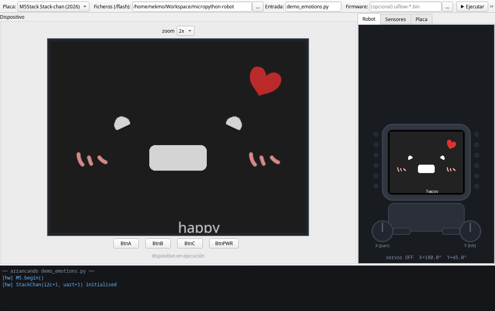

.. _intro:

############################
Usando Micropython de verdad
############################

.. revealjs-section::
    :data-scene: face
    :data-background-color: #000000
    :data-transition: fade
    :data-transition-speed: slow

.. stackchan-face::

.. rst-class:: kicker

Bienvenidos a la robótica

.. revealjs-notes::

   Hola a todos, muchas gracias por venir. Os presento a mi compañero de charla de hoy... (señalar al robot).
   Bueno, a la cara que veis en pantalla. Es Stack-chan, y durante esta charla va a ser nuestro conejillo de
   indias.

¡Hola, **PyConES**!
===================

.. revealjs-section::
    :data-scene: blueprint
    :data-background-color: #1F2A44
    :data-sheet: Hola mundo

.. micropython-demo::
    :file: demos/demo0_hola/demo.py
    :height: 560px

.. revealjs-notes::

   Antes de empezar, vamos a comprobar que todo funciona. Conecto el robot por USB, pulso en conectar, y en
   ejecutar. Este código se está enviando ahora mismo desde la presentación al robot. Si todo va bien, debería
   saludaros, encender sus LEDs y pitar. (Ejecutar). ¡Perfecto! Tenemos robot.

Sobre mí, **Nekmo**
===================

.. revealjs-section::
    :data-scene: sheet
    :data-background-color: #E9EEF2
    :data-sheet: Sobre mí
    :data-transition: fade

.. container:: about

    .. image:: images/cara.svg
       :width: 300px

    .. container:: about-text

        **Juan José**

        Nekmo en redes

        * Programador Python en Plytix.
        * Comunidad Python Málaga.
        * Charlas y talleres sobre Micropython.

.. revealjs-notes::

   Dejadme presentarme. Soy Juan José, aunque muchos me conocéis en redes como Nekmo. Soy programador Python, y
   puede que me conozcáis por charlas anteriores tanto aquí, en PyConES, como en Python Málaga.

2025, el año de los microcontroladores
--------------------------------------

.. revealjs-section::
    :data-scene: sheet
    :data-background-color: #E9EEF2
    :data-sheet: Sobre mí

.. container:: timeline

    * **OpenSouthCode** Charla en Málaga: Micropython, programación fácil y para todos de microcontroladores.
    * **PyConES 2025** Taller en Sevilla: los asistentes programaron sus propios ESP32 desde la presentación.
    * **PyConES 2026** Hoy: Micropython de verdad, en un robot de verdad.

.. revealjs-notes::

   El año pasado, 2025, fue para mí el año de los microcontroladores y de Micropython. Primero con una ponencia en
   OpenSouthCode, en Málaga, y luego aquí, en PyConES, en formato de taller, donde los asistentes programaron
   sus propios microcontroladores desde la misma presentación. Ambos tuvieron una gran acogida.

Otras **charlas**
-----------------

.. revealjs-section::
    :data-scene: blueprint
    :data-background-color: #1F2A44
    :data-sheet: Sobre mí

.. container:: centered

    .. image:: images/talks1.jpg
       :height: 400px

    .. image:: images/talks2.jpg
       :height: 400px

    |

    .. image:: images/python-malaga-logo-white.png
       :height: 70px

    .. image:: images/plytix-logo-white.svg
       :height: 56px

.. revealjs-notes::

   Si venís de Málaga, os recomiendo echarle un ojo a nuestra comunidad, Python Málaga, donde hacemos charlas,
   talleres, concursos y networking. Las fotos son de un evento en las oficinas de Plytix, donde trabajo.

La pregunta
===========

.. revealjs-section::
    :data-scene: face
    :data-background-color: #000000
    :data-transition: fade

.. stackchan-face::
    :size: small

.. rst-class:: big-question

¿Y esto para qué sirve?

.. revealjs-notes::

   Pero en ambas charlas llegaba siempre la misma pregunta. Al final, alguien levantaba la mano y decía: muy bonito
   lo de encender LEDs, pero... ¿y esto para qué sirve?

¿Algo más **serio**?
--------------------

.. revealjs-section::
    :data-scene: face
    :data-background-color: #000000

.. rst-class:: big-question

¿De verdad puede usarse Micropython en algo más serio?

.. revealjs-notes::

   O peor aún: ¿de verdad puede usarse Micropython en algo más serio? Pues bien, hoy vamos a demostrar que sí. Y
   lo vamos a hacer desde el mundo de la robótica.

Bienvenidos a la **robótica**
-----------------------------

.. revealjs-section::
    :data-scene: neon
    :data-background-color: #FF4F9A
    :data-transition: zoom

.. revealjs-notes::

   Bienvenidos todos a la robótica con Micropython.

Hoja de **ruta**
================

.. revealjs-section::
    :data-scene: sheet
    :data-background-color: #E9EEF2
    :data-sheet: Índice

#. Micropython en microcontroladores.
#. Casos de uso: programar a Stack-chan.
#. Primer reto: controlar los servos.
#. Segundo reto: sensores del robot.
#. Tercer reto: micrófono y cámara.
#. Cuarto reto: dibujar en la pantalla.
#. Quinto reto: inteligencia artificial en un ESP32.
#. Demostración completa con Stack-chan.

.. revealjs-notes::

   Este será nuestro camino. Primero un repaso rápido de qué es Micropython, para quienes no vinieron a las
   anteriores. Luego conoceremos a nuestro robot, y después iremos superando retos, cada uno con su demo en directo.
   Al final, juntaremos todo en una demostración completa.

Micropython en **microcontroladores**
=====================================

.. revealjs-section::
    :data-scene: blueprint
    :data-background-color: #1F2A44
    :data-sheet: Micropython
    :data-transition: fade

.. image:: images/micropython-logo.svg
   :width: 30%
   :align: center

.. revealjs-notes::

   Para quienes no vinierais a las charlas anteriores, un repaso rápido.

¿Qué es un **microcontrolador**?
--------------------------------

.. revealjs-section::
    :data-scene: sheet
    :data-background-color: #E9EEF2
    :data-sheet: Micropython

.. revealjs-fragments::

    * Un ordenador completo en un solo chip: CPU, memoria y periféricos.
    * 🤏 Pequeño, 🤑 económico y 🪫 de bajo consumo.
    * Habla directamente con el hardware: motores, sensores, LEDs...
    * Sin sistema operativo: tu programa es lo único que se ejecuta.

.. revealjs-notes::

   Un microcontrolador es un pequeño ordenador en un único chip. Al no tener sistema operativo, nuestro programa
   controla directamente el hardware, sin intermediarios. Por eso son perfectos para robótica: responden en tiempo
   real y gastan muy poco.

El cerebro: **ESP32-S3**
------------------------

.. revealjs-section::
    :data-scene: sheet
    :data-background-color: #E9EEF2
    :data-sheet: Micropython

.. revealjs-fragments::

    * 💪 Doble núcleo a 240 MHz.
    * 🧠 512 KB de SRAM y PSRAM externa de 8 MB.
    * 🛜 WiFi y 📡 Bluetooth LE.
    * 🧮 Instrucciones vectoriales para IA en el propio chip.
    * 🔌 USB nativo: se programa con el mismo cable que lo alimenta.

.. revealjs-notes::

   Stack-chan lleva un ESP32-S3. Es más potente que el ESP32 que usamos en el taller: tiene PSRAM, que nos permitirá
   trabajar con imágenes de la cámara, e instrucciones vectoriales, que acelerarán la inteligencia artificial que
   veremos en el quinto reto.

¿Qué es **Micropython**?
------------------------

.. revealjs-section::
    :data-scene: sheet
    :data-background-color: #E9EEF2
    :data-sheet: Micropython

.. revealjs-fragments::

    * Una implementación de Python 3 para microcontroladores.
    * Intérprete y REPL en el propio chip, en 256 KB de flash.
    * Módulos para el hardware: ``machine``, ``network``, ``asyncio``...
    * Compatible con la mayor parte de lo que ya sabes de Python.

.. revealjs-notes::

   Micropython es una versión de Python 3 reducida y adaptada a microcontroladores. Lo más importante: incluye el
   intérprete y una consola interactiva dentro del propio chip, así que podemos enviarle código sin compilar
   nada, como vamos a hacer hoy desde la presentación.

¿Por qué en **robótica**?
-------------------------

.. revealjs-section::
    :data-scene: sheet
    :data-background-color: #E9EEF2
    :data-sheet: Micropython

.. revealjs-fragments::

    * 🔁 Probar un movimiento lleva segundos, no minutos de compilación.
    * 🐍 El mismo lenguaje en el robot, en el servidor y en la IA.
    * ⚡ Cuando hace falta velocidad: ``@micropython.viper`` o módulos en C.
    * 🧪 Se puede simular y probar en el ordenador.

.. revealjs-notes::

   ¿Y por qué usarlo en robótica, si el firmware oficial está en C++? Porque en robótica se itera muchísimo: ajustas
   un ángulo, pruebas, ajustas otra vez. Con Micropython, cada prueba son segundos. Y cuando necesitamos velocidad,
   tenemos decoradores como viper, o podemos escribir módulos en C para las partes críticas.

Nuestras **herramientas**
-------------------------

.. revealjs-section::
    :data-scene: sheet
    :data-background-color: #E9EEF2
    :data-sheet: Micropython

.. revealjs-fragments::

    * 📦 **UIFlow 2**: el firmware Micropython de M5Stack, con soporte para el robot.
    * 🧰 **mpytool**: subir ficheros y reiniciar desde la terminal.
    * 🥽 **esp-emulator**: simulador de Stack-chan, también dentro de esta presentación.
    * 🖥️ **Esta presentación**: envía código al robot por Web Serial.

.. revealjs-notes::

   Estas son las herramientas que usaremos. UIFlow 2 es el firmware de Micropython de M5Stack, que trae los módulos
   para controlar el robot. Mpytool para subir ficheros. Un simulador que he desarrollado para poder probar el
   código sin el robot. Y la propia presentación, que se comunica con el robot por el puerto serie del navegador.

Casos de **uso**
================

.. revealjs-section::
    :data-scene: neon
    :data-background-color: #FF4F9A
    :data-transition: fade

Programar a Stack-chan

.. revealjs-notes::

   Vamos con los casos de uso. ¿Qué podemos construir con Micropython? Os presento al robot de hoy.

Os presento a **Stack-chan**
----------------------------

.. revealjs-section::
    :data-scene: sheet
    :data-background-color: #E9EEF2
    :data-sheet: Stack-chan

.. container:: two-cols

    .. container::

        .. revealjs-fragments::

            * Un robot adorable, nacido en la comunidad japonesa.
            * Software open source y hardware libre.
            * Se vende ya montado y a un precio asequible.
            * Una gran comunidad de usuarios y extensiones.

    .. container::

        .. camera-view::
            :mode: side

.. revealjs-notes::

   Este es Stack-chan. Es un robot open source y de hardware libre, creado por la comunidad japonesa, que ha
   enamorado a medio mundo. Lo mejor es que hoy podéis comprarlo ya montado, a un precio asequible, sin soldar
   nada. Lo tenéis aquí en la cámara. Saluda, Stack-chan.

**Anatomía** de Stack-chan
--------------------------

.. revealjs-section::
    :data-scene: sheet
    :data-background-color: #E9EEF2
    :data-sheet: Stack-chan

.. stackchan-3d::
    :mode: anatomy
    :height: 620px

.. revealjs-notes::

   Veamos qué lleva dentro. La cabeza es un ordenador completo: pantalla táctil, cámara, micrófono, altavoz, un
   acelerómetro y el ESP32-S3. Arriba, un sensor táctil con tres zonas y doce LEDs. Y en el cuerpo, la batería y dos
   servos: uno para girar y otro para inclinar la cabeza. Podéis girar el modelo con el ratón.

Hoja de **especificaciones**
----------------------------

.. revealjs-section::
    :data-scene: sheet
    :data-background-color: #E9EEF2
    :data-sheet: Stack-chan

.. container:: spec

    Servos
        2 servos de bus serie (UART), con lectura de posición.
    Sensores
        Táctil Si12T (3 zonas), IMU BMI270, luz y proximidad LTR-553.
    Multimedia
        Pantalla de 320×240, cámara GC0308, micrófono y altavoz I2S.
    Luces
        12 LEDs RGB en dos tiras de 6.
    Energía
        Batería con monitor INA226.

.. revealjs-notes::

   Esta es la hoja de especificaciones, que iremos recorriendo en cada reto. Fijaos en que los servos son de bus
   serie: no son los servos baratos de modelismo, sino servos que nos pueden decir dónde están.

Firmware en **Micropython**
---------------------------

.. revealjs-section::
    :data-scene: blueprint
    :data-background-color: #1F2A44
    :data-sheet: Stack-chan

.. revealjs-fragments::

    * El firmware oficial de 2026 está escrito en C++.
    * Lo he portado a Micropython: **stackchan-micropython**.
    * Avatar, emociones, bailes, servos con muelles amortiguados, control remoto...
    * Unas 3.600 líneas de Python, módulo a módulo con el original.

.. revealjs-notes::

   El firmware oficial de Stack-chan está en C++. Para demostrar que Micropython sirve para algo serio, lo he
   portado entero: el avatar con sus emociones, los bailes, el movimiento de los servos con física de muelles, el
   control remoto... Unas 3600 líneas de Python que funcionan en el robot y en el simulador.

Un **simulador** propio
-----------------------

.. revealjs-section::
    :data-scene: blueprint
    :data-background-color: #1F2A44
    :data-sheet: Stack-chan

.. revealjs-notes::

   Y como no siempre tengo el robot a mano, he hecho un simulador: esp-emulator. Ejecuta el mismo código de
   Micropython, con la pantalla, los servos, los LEDs, los sensores e incluso el micrófono. Y una versión de él
   funciona dentro de esta misma presentación, en el navegador, por si el robot decide no colaborar.

¿Por qué **Stack-chan**?
------------------------

.. revealjs-section::
    :data-scene: sheet
    :data-background-color: #E9EEF2
    :data-sheet: Stack-chan

.. container:: robots

    * **Stack-chan** Ya montado: sacar de la caja y programar.
    * **Robot DIY** Chasis, motores, drivers y soldador: semanas de montaje.
    * **Tu robot** Empieza por uno montado y aprende electrónica después.

.. revealjs-notes::

   ¿Por qué Stack-chan? Montar un robot desde cero exige chasis, motores, controladores, soldar y bastantes
   conocimientos de electrónica: semanas de trabajo antes de escribir la primera línea de código. Stack-chan llega
   montado, así que podemos centrarnos en lo que hoy nos importa: programarlo en Micropython. Cuando lo domines, el
   salto a un robot hecho por ti será mucho más fácil.

Primer reto: los **servos**
===========================

.. revealjs-section::
    :data-scene: face
    :data-background-color: #000000
    :data-transition: fade

.. stackchan-face::
    :size: small

.. rst-class:: dimension

Reto 1 de 5

.. revealjs-notes::

   Primer reto: que Stack-chan se mueva. Para eso, tenemos que controlar sus servos.

¿Cómo funciona un **servo**?
----------------------------

.. revealjs-section::
    :data-scene: sheet
    :data-background-color: #E9EEF2
    :data-sheet: Reto 1: servos

.. revealjs-fragments::

    * Un motor, una reductora y un sensor de posición.
    * Le pedimos un ángulo y él mismo corrige hasta llegar.
    * Los de modelismo se controlan por PWM: solo escuchan.
    * Los de bus serie, como los de Stack-chan, también responden.

.. revealjs-notes::

   Un servo es un motor con un sensor de posición. Nosotros le pedimos un ángulo y él se encarga de llegar. Los
   servos baratos de modelismo se controlan con pulsos PWM y no nos dicen nada. Los de Stack-chan usan un bus
   serie: podemos preguntarles en qué ángulo están, cuánta corriente consumen, o dejarlos sueltos para moverlos a
   mano.

Servo de **modelismo** (PWM)
----------------------------

.. revealjs-section::
    :data-scene: sheet
    :data-background-color: #E9EEF2
    :data-sheet: Reto 1: servos

.. code-block:: python

    from machine import Pin, PWM

    servo = PWM(Pin(5), freq=50)       # one pulse every 20 ms

    def angle(degrees):
        # 0.5 ms = 0°, 2.5 ms = 180°
        pulse_ns = 500_000 + degrees * 2_000_000 // 180
        servo.duty_ns(pulse_ns)

    angle(90)

.. revealjs-notes::

   Para que veáis la diferencia, así se controla un servo de modelismo, como los de muchos robots que se montan a
   mano. Enviamos un pulso cada 20 milisegundos, y la duración del pulso indica el ángulo. Sencillo, pero el servo nunca
   nos dirá si ha llegado o si algo lo bloquea.

Servos de **Stack-chan**
------------------------

.. revealjs-section::
    :data-scene: sheet
    :data-background-color: #E9EEF2
    :data-sheet: Reto 1: servos

.. code-block:: python

    from hardware.stackchan import StackChan

    robot = StackChan(i2c=1, uart=1)
    robot.set_servo_power(True)                 # power rail
    robot.set_servo_torque(robot.SERVO_ID_X, True)

    robot.set_servo_angle(robot.SERVO_ID_X, 200, 300)   # degrees, ms
    print(robot.get_servo_angle(robot.SERVO_ID_X))      # where is it?
    print(robot.get_servo_current(robot.SERVO_ID_X))    # is it working hard?

.. revealjs-notes::

   Con Stack-chan es aún más fácil. Activamos la alimentación y el par, y le pedimos un ángulo y el tiempo para
   llegar. Y además podemos leer el ángulo actual y la corriente. Si desactivamos el par, podemos mover la cabeza a
   mano y leer la posición: así se graban movimientos.

Pruébalo **tú**
---------------

.. revealjs-section::
    :data-scene: sheet
    :data-background-color: #E9EEF2
    :data-sheet: Reto 1: servos

.. stackchan-3d::
    :mode: servos
    :height: 600px

.. revealjs-notes::

   Antes de tocar el robot de verdad, juguemos con el modelo. Al mover los controles, a la derecha vemos el código
   equivalente. El eje X gira la cabeza, el Y la inclina.

Demo: **sí** y **no**
---------------------

.. revealjs-section::
    :data-scene: blueprint
    :data-background-color: #1F2A44
    :data-sheet: Reto 1: servos

.. micropython-demo::
    :file: demos/demo1_servos/demo.py

.. revealjs-notes::

   Ahora sí, en el robot. Guardamos la posición inicial como "mirar al frente", y definimos una función look que
   mueve la cabeza relativa a esa posición. Con eso, decir que no es girar a un lado y a otro, y decir que sí es
   inclinar. (Ejecutar.) Fijaos en la cámara.

Demo: movimiento **natural**
----------------------------

.. revealjs-section::
    :data-scene: blueprint
    :data-background-color: #1F2A44
    :data-sheet: Reto 1: servos

.. micropython-demo::
    :file: demos/demo2_mirada/demo.py

.. revealjs-notes::

   El movimiento anterior es muy robótico: arranca y frena de golpe. Para que parezca vivo, interpolamos con una
   curva de aceleración, ease in out: empieza despacio, acelera y frena suavemente. Es lo que hacen los
   animadores. El firmware completo va más allá y usa un sistema de muelles amortiguados.

El mismo código, en el **simulador**
------------------------------------

.. revealjs-section::
    :data-scene: blueprint
    :data-background-color: #1F2A44
    :data-sheet: Reto 1: servos

.. stackchan-3d::
    :mode: mirror
    :height: 620px
    :file: demos/demo2_mirada/demo.py

.. revealjs-notes::

   Y si no tenéis un Stack-chan, el mismo código funciona en el simulador, que corre dentro de esta misma
   presentación: es Micropython compilado a WebAssembly, con los módulos del robot simulados. Este modelo 3D sigue
   al simulador en tiempo real: los servos, los LEDs y su pantalla. (Pulsar en ejecutar.) En cualquier demo podéis
   elegir "Simulador" en lugar de "Robot (USB)".

Segundo reto: los **sensores**
==============================

.. revealjs-section::
    :data-scene: face
    :data-background-color: #000000
    :data-transition: fade

.. stackchan-face::
    :size: small

.. rst-class:: dimension

Reto 2 de 5

.. revealjs-notes::

   Ya se mueve. Pero un robot que no siente lo que pasa a su alrededor es solo una marioneta. Segundo reto: los
   sensores.

¿Qué **siente** Stack-chan?
---------------------------

.. revealjs-section::
    :data-scene: sheet
    :data-background-color: #E9EEF2
    :data-sheet: Reto 2: sensores

.. revealjs-fragments::

    * ✋ **Táctil**: tres zonas en la cabeza para acariciarlo.
    * 🧭 **IMU**: acelerómetro y giroscopio, sabe si lo inclinas o lo agitas.
    * 💡 **Luz y proximidad**: sabe si hay luz y si te acercas.
    * 🔋 **Batería**: tensión, corriente y potencia.

.. revealjs-notes::

   Stack-chan tiene un sensor táctil en la cabeza, dividido en tres zonas, con el que detecta caricias. Una IMU que
   le dice si lo inclinamos o lo agitamos. Un sensor de luz y proximidad junto a la pantalla. Y un monitor de
   batería. Todo esto se comunica por I2C, que vimos en el taller.

Demo: **acaríciame**
--------------------

.. revealjs-section::
    :data-scene: blueprint
    :data-background-color: #1F2A44
    :data-sheet: Reto 2: sensores

.. micropython-demo::
    :file: demos/demo3_cabeza/demo.py

.. revealjs-notes::

   get_touch nos devuelve una lista con las tres zonas. Asignamos un color a cada zona y pitamos con un tono
   distinto. (Ejecutar y acariciar la cabeza de delante a atrás.) Con las tres zonas podemos detectar incluso la
   dirección de la caricia, que es lo que hace el firmware completo.

Demo: **nivel** de burbuja
--------------------------

.. revealjs-section::
    :data-scene: blueprint
    :data-background-color: #1F2A44
    :data-sheet: Reto 2: sensores

.. micropython-demo::
    :file: demos/demo4_imu/demo.py

.. revealjs-notes::

   Con la IMU leemos la aceleración en cada eje, en g. Si el robot está quieto, solo mide la gravedad, así que la
   inclinación nos dice hacia dónde está ladeado. Convertimos esa inclinación en la posición de un LED, como un
   nivel de burbuja. Y si lo agitamos, se enfada.

Demo: Stack-chan **tímido**
---------------------------

.. revealjs-section::
    :data-scene: blueprint
    :data-background-color: #1F2A44
    :data-sheet: Reto 2: sensores

.. micropython-demo::
    :file: demos/demo5_proximidad/demo.py

.. revealjs-notes::

   El sensor de proximidad emite luz infrarroja y mide cuánta rebota. Cuando acercamos la mano, Stack-chan se pone
   colorado y aparta la mirada. Cuando la retiramos, vuelve a mirarnos. Aquí ya combinamos un sensor con los
   servos: es el ciclo básico de cualquier robot. Percibir, decidir, actuar.

Tercer reto: **micrófono** y **cámara**
=======================================

.. revealjs-section::
    :data-scene: face
    :data-background-color: #000000
    :data-transition: fade

.. stackchan-face::
    :size: small

.. rst-class:: dimension

Reto 3 de 5

.. revealjs-notes::

   Tercer reto: los sentidos más exigentes. Oír y ver. Aquí es donde mucha gente cree que Micropython no llega.

**Oír**: el micrófono
---------------------

.. revealjs-section::
    :data-scene: sheet
    :data-background-color: #E9EEF2
    :data-sheet: Reto 3: audio

.. revealjs-fragments::

    * El audio llega por I2S: 16.000 muestras de 16 bits por segundo.
    * Micrófono y altavoz comparten el bus: uno a la vez.
    * Grabamos en un ``array`` para no crear objetos en cada muestra.
    * Con el pico de cada bloque ya sabemos si hay ruido.

.. revealjs-notes::

   El micrófono nos da 16000 números por segundo. Parece mucho para un microcontrolador, pero si grabamos en un
   array preasignado, Micropython no crea un objeto por muestra y va sobrado. El truco de rendimiento en
   Micropython casi siempre es el mismo: evitar crear objetos en los bucles.

Demo: **vúmetro**
-----------------

.. revealjs-section::
    :data-scene: blueprint
    :data-background-color: #1F2A44
    :data-sheet: Reto 3: audio

.. micropython-demo::
    :file: demos/demo6_microfono/demo.py

.. revealjs-notes::

   Grabamos bloques de 50 milisegundos, calculamos el pico y encendemos tantos LEDs como fuerte sea el sonido.
   (Ejecutar.) ¿Me ayudáis con un aplauso? ... ¡Gracias! Era para la demo, pero me lo quedo.

**Ver**: la cámara
------------------

.. revealjs-section::
    :data-scene: sheet
    :data-background-color: #E9EEF2
    :data-sheet: Reto 3: cámara

.. revealjs-fragments::

    * Cámara GC0308 de 0,3 megapíxeles, bajo la pantalla.
    * Una imagen QVGA en RGB565 ocupa 150 KB: va a la PSRAM.
    * ``camera.snapshot()`` captura, ``M5.Lcd.show()`` la pinta.

.. revealjs-notes::

   La cámara es modesta, 0,3 megapíxeles, pero suficiente para un robot. Cada imagen de 320 por 240 ocupa 150 KB,
   más que toda la SRAM libre, así que vive en la PSRAM. Por eso necesitábamos un ESP32-S3.

Demo: lo que **ve** Stack-chan
------------------------------

.. revealjs-section::
    :data-scene: blueprint
    :data-background-color: #1F2A44
    :data-sheet: Reto 3: cámara

.. micropython-demo::
    :file: demos/demo7_camara/demo.py

.. revealjs-notes::

   Capturamos y pintamos en un bucle. (Ejecutar.) Ahora tenemos una cámara grabando a un robot que muestra lo que
   graba su cámara. Si apunto mi cámara a su pantalla... recursividad en hardware.

La vista desde **aquí**
-----------------------

.. revealjs-section::
    :data-scene: blueprint
    :data-background-color: #1F2A44
    :data-sheet: Reto 3: cámara

.. camera-view::
    :mode: full

.. revealjs-notes::

   Veámoslo en grande. (Acercar a Stack-chan al público para que se vea en su pantalla.)

Cuarto reto: la **pantalla**
============================

.. revealjs-section::
    :data-scene: face
    :data-background-color: #000000
    :data-transition: fade

.. stackchan-face::
    :size: small

.. rst-class:: dimension

Reto 4 de 5

.. revealjs-notes::

   Cuarto reto: la pantalla. Es la cara de Stack-chan, y una cara bien hecha es lo que hace que un robot parezca
   tener personalidad.

Dos formas de **dibujar**
-------------------------

.. revealjs-section::
    :data-scene: sheet
    :data-background-color: #E9EEF2
    :data-sheet: Reto 4: pantalla

.. container:: two-cols

    .. container::

        **M5GFX**

        * Primitivas: rectángulos, círculos, texto.
        * Pintas y te olvidas.
        * Ideal para empezar.

    .. container::

        **LVGL**

        * Objetos con estilos y animaciones.
        * Solo repinta lo que cambia.
        * Lo que usa el firmware real.

.. revealjs-notes::

   Tenemos dos formas de dibujar. Con M5GFX pintamos primitivas directamente: rápido de entender. Con LVGL creamos
   objetos con estilos, y la librería se encarga de repintar solo lo que cambia, que es lo que necesitamos para
   animaciones fluidas.

Demo: dibujar una **cara**
--------------------------

.. revealjs-section::
    :data-scene: blueprint
    :data-background-color: #1F2A44
    :data-sheet: Reto 4: pantalla

.. micropython-demo::
    :file: demos/demo8_pantalla/demo.py

.. revealjs-notes::

   Dos círculos y un rectángulo: no hace falta más para una cara. Para que parezca viva, añadimos dos detalles:
   mira a un lado y a otro al azar, y parpadea. Fijaos en que el parpadeo dura solo 120 milisegundos, como el de
   una persona.

Demo: **emociones**
-------------------

.. revealjs-section::
    :data-scene: blueprint
    :data-background-color: #1F2A44
    :data-sheet: Reto 4: pantalla

.. micropython-demo::
    :file: demos/demo9_avatar/demo.py

.. revealjs-notes::

   Y esta es la cara real de Stack-chan, del port del firmware a Micropython, hecha con LVGL. Le añadimos
   modificadores de parpadeo y respiración, y recorremos sus emociones: contento, enfadado, triste, dudoso y con
   sueño. Cada emoción es solo un conjunto de pesos y rotaciones para los ojos y la boca.

Quinto reto: **inteligencia artificial**
========================================

.. revealjs-section::
    :data-scene: face
    :data-background-color: #000000
    :data-transition: fade

.. stackchan-face::
    :size: small

.. rst-class:: dimension

Reto 5 de 5

.. revealjs-notes::

   Y el último reto, el que todos estabais esperando: inteligencia artificial. En un ESP32.

Dos **caminos**
---------------

.. revealjs-section::
    :data-scene: sheet
    :data-background-color: #E9EEF2
    :data-sheet: Reto 5: IA

.. container:: two-cols

    .. container::

        **En el propio chip**

        * Detección de caras y objetos (ESP-DL).
        * Modelos pequeños: TFLite Micro, emlearn.
        * Sin red, sin latencia, sin enviar datos.

    .. container::

        **En la nube**

        * Modelos de lenguaje por HTTPS.
        * Agentes de voz para ESP32.
        * Toda la potencia, a cambio de red.

.. revealjs-notes::

   Hay dos caminos. Ejecutar modelos pequeños en el propio chip, que es privado e instantáneo, pero limitado. O
   llamar a un modelo grande en la nube, que es muchísimo más capaz, pero necesita red. Un buen robot combina los
   dos: reflejos en local, razonamiento en la nube.

Demo: **sígueme**
-----------------

.. revealjs-section::
    :data-scene: blueprint
    :data-background-color: #1F2A44
    :data-sheet: Reto 5: IA

.. micropython-demo::
    :file: demos/demo10_caras/demo.py

.. revealjs-notes::

   Primero, en local. El detector de caras corre en el ESP32-S3 usando sus instrucciones vectoriales. Calculamos
   lo lejos que está la cara del centro de la imagen, y movemos los servos proporcionalmente a ese error. Esto se
   llama control proporcional, y es la base del control en robótica. (Ejecutar y moverse delante del robot.)

Control **proporcional**
------------------------

.. revealjs-section::
    :data-scene: sheet
    :data-background-color: #E9EEF2
    :data-sheet: Reto 5: IA

.. code-block:: python

    error = face_x - 160          # how far from the centre?
    yaw -= error * 0.05           # correct a fraction of it

.. revealjs-fragments::

    * Si la ganancia es muy baja, el robot llega tarde.
    * Si es muy alta, se pasa y oscila.
    * Ajustarla en vivo, sin compilar, es donde Micropython brilla.

.. revealjs-notes::

   Dos líneas. Si la ganancia, ese 0,05, es muy pequeña, el robot reacciona tarde. Si es muy grande, se pasa de
   largo y oscila. Encontrar el valor es cuestión de probar, y probar en vivo es justo lo que Micropython nos
   permite.

Demo: pregúntale a **Claude**
-----------------------------

.. revealjs-section::
    :data-scene: blueprint
    :data-background-color: #1F2A44
    :data-sheet: Reto 5: IA

.. micropython-demo::
    :file: demos/demo11_claude/demo.py

.. revealjs-notes::

   Y ahora, en la nube. Conectamos a la WiFi y hacemos una petición HTTPS a la API de Claude, de Anthropic, desde
   el propio ESP32. Le damos una personalidad con el mensaje de sistema: eres Stack-chan, un pequeño robot. La
   clave de la API está en un fichero secrets.py en el robot, nunca en la presentación. (Ejecutar.)

Los **límites**
---------------

.. revealjs-section::
    :data-scene: sheet
    :data-background-color: #E9EEF2
    :data-sheet: Reto 5: IA

.. revealjs-fragments::

    * 🧠 Memoria: modelos de pocos megas, imágenes pequeñas.
    * 🛜 Red: sin WiFi, solo queda la IA local.
    * 🔋 Batería: la WiFi y los servos son lo que más consume.
    * 🔐 Secretos: las claves viven en el robot, no en el código.

.. revealjs-notes::

   No todo es magia. Tenemos megas, no gigas, de memoria. Sin red no hay modelo grande. La WiFi y los servos se
   comen la batería. Y si nuestro robot llama a una API, sus claves tienen que estar protegidas.

Demostración **completa**
=========================

.. revealjs-section::
    :data-scene: neon
    :data-background-color: #FF4F9A
    :data-transition: zoom

Todo junto, en Stack-chan

.. revealjs-notes::

   Hemos superado los cinco retos. Ahora vamos a juntarlo todo.

Demo: ¡a **bailar**!
--------------------

.. revealjs-section::
    :data-scene: blueprint
    :data-background-color: #1F2A44
    :data-sheet: Demo final

.. micropython-demo::
    :file: demos/demo12_final/demo.py

.. revealjs-notes::

   Esta demo usa el port completo del firmware: el avatar con su cara, los servos con física de muelles, los LEDs,
   y los modificadores. Mientras baila, podéis acariciarle la cabeza o agitarlo, y reaccionará. (Ejecutar.)

Stack-chan, **en vivo**
-----------------------

.. revealjs-section::
    :data-scene: blueprint
    :data-background-color: #1F2A44
    :data-sheet: Demo final

.. camera-view::
    :mode: full

.. revealjs-notes::

   Y ahora, el firmware completo en Micropython, como viene de fábrica: el lanzador de aplicaciones, el avatar con
   sus emociones, los bailes y el control remoto. ¿Alguien quiere subir a acariciarlo? (Reiniciar el robot para
   que arranque main.py, y dejar que el público interactúe con él.)

¡Muchas **gracias**!
====================

.. revealjs-section::
    :data-scene: face
    :data-background-color: #000000
    :data-transition: fade

.. stackchan-face::

.. revealjs-notes::

    ¡Hasta aquí la presentación! Espero que la próxima vez que alguien pregunte para qué sirve Micropython, tengáis
    un robot que responda por vosotros. Muchas gracias. Stack-chan también os da las gracias.

Recursos
========

.. revealjs-section::
    :data-scene: blueprint
    :data-background-color: #1F2A44
    :data-sheet: Recursos
    :data-transition: fade

.. revealjs-fragments::

    * 🌐 **Micropython**: https://micropython.org
    * 🤖 **Stack-chan**: https://github.com/stack-chan
    * 📦 **UIFlow 2**: https://uiflow2.m5stack.com
    * 📝 **Editor online**: https://viper-ide.org

.. revealjs-notes::

   Os dejo aquí los recursos para empezar a programar robots con Micropython.

QR
==

.. revealjs-section::
    :data-scene: sheet
    :data-background-color: #E9EEF2
    :data-sheet: Presentación
    :data-transition: fade

.. image:: images/qr.svg
    :width: 40%
    :align: center
    :class: qr

.. revealjs-notes::

   Y por supuesto, tenéis esta misma presentación, con todas las demos, en el código QR.

Python **Málaga**
=================

.. revealjs-section::
    :data-scene: neon
    :data-background-color: #FF4F9A
    :data-transition: fade

* 🌐 **Sitio web:** `python-malaga.es <https://www.python-malaga.es/>`_.
* 🤝 **Meetup:** `meetup.com/Python-Malaga <https://www.meetup.com/Python-Malaga/>`_.
* 🐦 **Twitter:** `@python_malaga <https://twitter.com/python_malaga>`_.
* ‍💼 **LinkedIn:** `linkedin.com/groups/13110576 <https://www.linkedin.com/groups/13110576/>`_.
* 📱 **Telegram:** `python_malaga <https://t.me/python_malaga>`_.

.. revealjs-notes::

   Y para más charlas y talleres como este, uníos a la comunidad de Python Málaga. No olvidéis seguirnos en
   nuestras redes sociales y en nuestro grupo de Telegram.

**Contactar**
-------------

.. revealjs-section::
    :data-scene: blueprint
    :data-background-color: #1F2A44
    :data-sheet: Contacto
    :data-transition: fade

* 🌐 **Sitio web:** `nekmo.com <https://nekmo.com>`_
* 📫 **Email:** `contacto@nekmo.com <mailto:contacto@nekmo.com>`_
* 🐦 **Twitter:** `@nekmocom <https://twitter.com/nekmocom>`_
* 📱 **Telegram:** `@nekmo <https://t.me/nekmo>`_
* 💡 **Jabber:** `nekmo@nekmo.org <xmpp://nekmo@nekmo.org>`_

.. revealjs-notes::

   A cualquier cosa, tenéis mi contacto disponible. ¿Preguntas?
